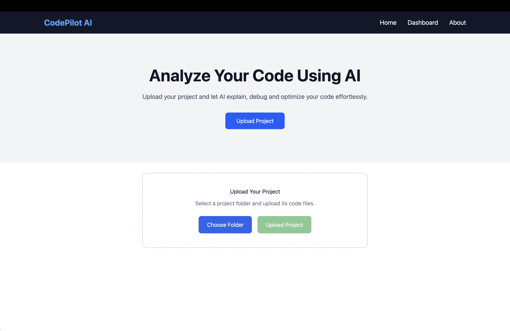
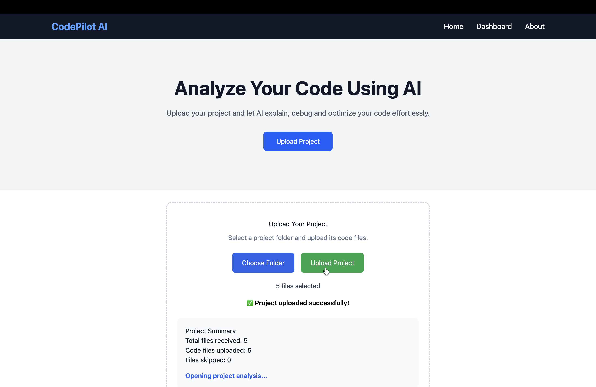
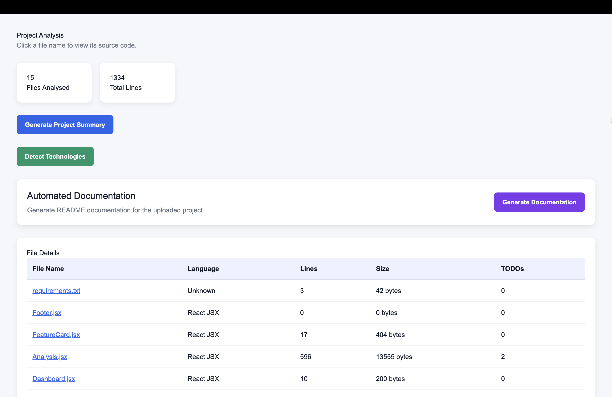
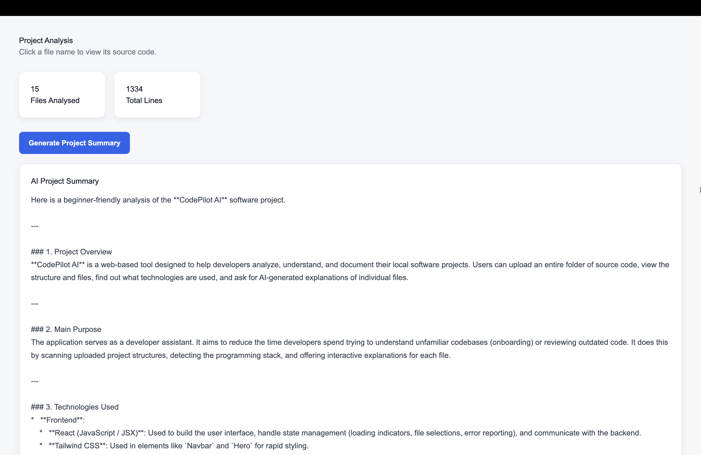
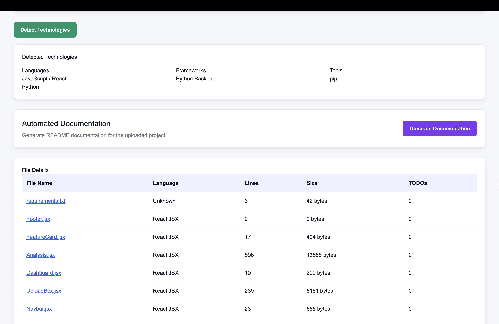
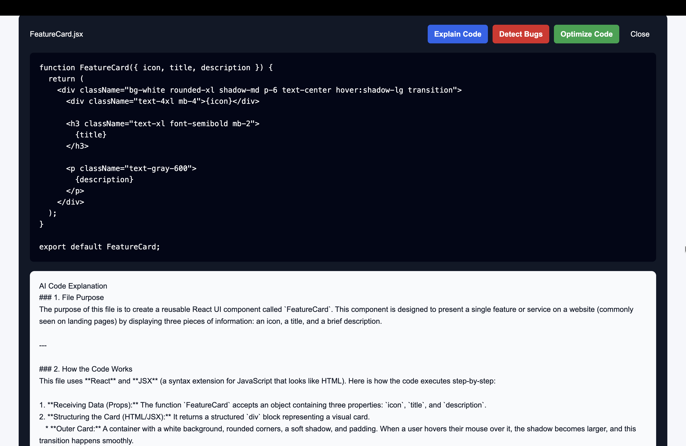
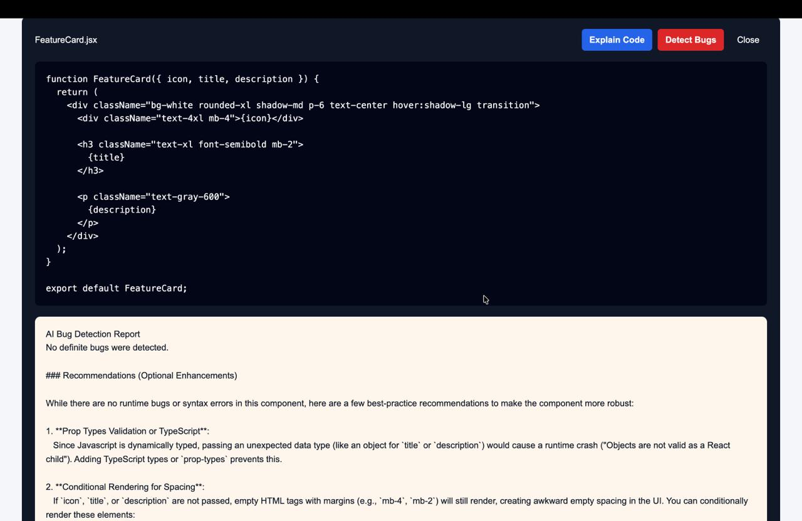
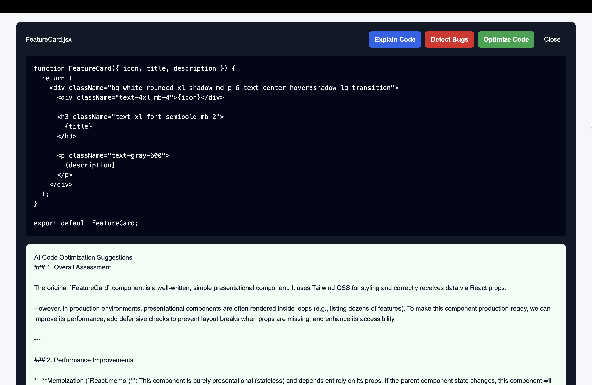
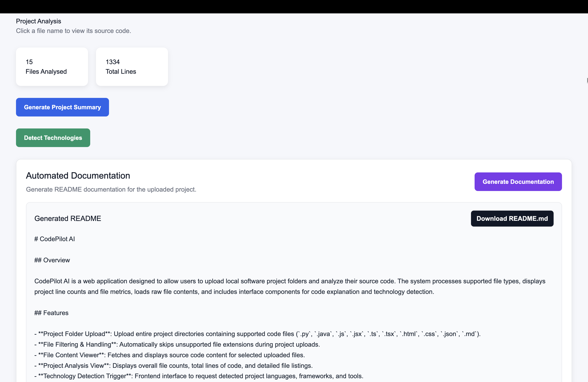

# CodePilot AI

**CodePilot AI** is a full-stack AI-powered code analysis platform that helps users upload, explore, understand, review, and document software projects through a simple web interface.

The application combines a **React frontend**, a **FastAPI backend**, and **Gemini-powered AI features** to analyse complete project folders and individual source-code files.

---

## Features

- Upload multiple source-code files or an entire project folder
- Filter supported files and ignore unsupported file types
- View the total number of analysed files and lines of code
- Browse individual files and view their source code
- Generate an AI-powered summary of the uploaded project
- Detect programming languages, frameworks, libraries, and tools
- Generate beginner-friendly code explanations
- Identify possible bugs and code-quality issues
- Generate code optimisation suggestions
- Automatically generate README documentation
- Download the generated documentation as a Markdown file

---

## Screenshots

### Home Page



### Project Upload



### Project Analysis



### Source-Code Viewer


### AI Project Summary



### Technology Detection



### AI Code Explanation



### AI Bug Detection



### AI Code Optimisation



### AI Documentation Generation



---

## Tech Stack

### Frontend

- React.js
- JavaScript
- Vite
- CSS3
- React Router

### Backend

- FastAPI
- Python
- Uvicorn
- Pydantic
- REST APIs

### AI Integration

- Google Gemini API
- Prompt-based code and project analysis

### Development Tools

- Git
- GitHub
- Visual Studio Code
- Postman / FastAPI Swagger UI

---

## Supported File Types

CodePilot AI currently supports:

```text
.py
.java
.js
.jsx
.ts
.tsx
.html
.css
.json
.md
.txt
```

Folders such as `node_modules`, `.git`, virtual environments, build folders, and Python cache folders can be excluded from project analysis.

---

## Project Workflow

```text
User uploads files or a project folder
              ↓
React sends the files to the FastAPI backend
              ↓
The backend stores and analyses supported files
              ↓
The user views project statistics and source code
              ↓
Selected project data or code is sent to Gemini
              ↓
AI-generated analysis is displayed in the frontend
```

---

## Project Structure

```text
CodePilot-AI/
├── backend/
│   ├── app.py
│   ├── services/
│   ├── uploads/
│   ├── requirements.txt
│   └── .env
├── frontend/
│   ├── src/
│   │   ├── components/
│   │   ├── pages/
│   │   └── services/
│   ├── package.json
│   └── vite.config.js
├── screenshots/
├── .gitignore
└── README.md
```

> The `.env` file is ignored by Git and must never be uploaded to GitHub.

---

## Getting Started

### Prerequisites

Install the following before running the project:

- Python 3.10 or later
- Node.js and npm
- Git
- A Google Gemini API key

---

## Backend Setup

### 1. Clone the repository

```bash
git clone https://github.com/Induja2210/CodePilot-AI.git
cd CodePilot-AI
```

### 2. Open the backend folder

```bash
cd backend
```

### 3. Create a virtual environment

```bash
python3 -m venv env
```

### 4. Activate the virtual environment

#### macOS or Linux

```bash
source env/bin/activate
```

#### Windows

```bash
env\Scripts\activate
```

### 5. Install backend dependencies

```bash
pip install -r requirements.txt
```

### 6. Create the environment file

Create a file named `.env` inside the `backend` folder:

```env
GEMINI_API_KEY=your_gemini_api_key
```

### 7. Start the FastAPI server

```bash
uvicorn app:app --reload
```

The backend will run at:

```text
http://127.0.0.1:8000
```

FastAPI Swagger documentation:

```text
http://127.0.0.1:8000/docs
```

---

## Frontend Setup

Open a new terminal from the project root.

### 1. Open the frontend folder

```bash
cd frontend
```

### 2. Install frontend dependencies

```bash
npm install
```

### 3. Start the development server

```bash
npm run dev
```

The frontend will usually run at:

```text
http://localhost:5173
```

---

## API Overview

The backend provides REST endpoints for operations such as:

- Uploading files and project folders
- Analysing uploaded files
- Viewing source-code content
- Generating project summaries
- Detecting technologies
- Explaining code
- Detecting possible bugs
- Suggesting code optimisations
- Generating project documentation

The available routes can be tested through FastAPI Swagger UI at `/docs`.

---

## Security

- API keys are stored in `backend/.env`
- `.env` files are excluded through `.gitignore`
- Virtual environments and Python cache files are not committed
- Unsupported file types are skipped during upload
- Large source files can be limited before being sent to the AI model

Never place API keys directly inside source-code files.

---

## Current Status

CodePilot AI currently provides an end-to-end working MVP for project upload, codebase analysis, source-code viewing, AI project summarisation, technology detection, code explanation, bug detection, code optimisation, and automated documentation generation.

Future improvements may include:

- Automated unit-test generation
- Documentation export in additional formats
- Code-complexity analysis
- Pull-request review
- Persistent project history
- User authentication
- Database integration
- Improved handling of large repositories
- Agentic multi-step code review workflows

---

## Author

**Induja B**  
B.Tech Computer Science and Engineering — Artificial Intelligence and Machine Learning

- GitHub: [Induja2210](https://github.com/Induja2210)

---

## Acknowledgements

- [FastAPI](https://fastapi.tiangolo.com/)
- [React](https://react.dev/)
- [Vite](https://vite.dev/)
- [Google Gemini](https://ai.google.dev/)

---

## License

This project is currently intended for educational and portfolio purposes.
